<p align="center">
  
</p>

```yaml
engineer_card:
  name: Zohair Maken
  role: AI & MLOps Engineer
  core_domains: [GenAI Platforms, MLOps & Lifecycle, Computer Vision, Cybersecurity AI]
  primary_stack: [Python, TensorFlow, PyTorch, MLflow, Docker, FastAPI, Streamlit, C++]
  engineering_focus:
    - Productionizing ML workflows with experiment tracking, Makefiles & automated CI/CD
    - Building multimodal AI systems (lecture intelligence, speech-to-text, Q&A assistants)
    - Deep learning architectures for vision classification and network anomaly detection
  status: open to Software Engineering, AI/ML & MLOps roles
```

---

### 🚀 Featured Work

| Project | What it does | Built with | Highlights & Result |
|---|---|---|---|
| **[LECTRA-AI](https://github.com/zohairmaken/LECTRA-AI-_AI_Lecture_Intelligence_System-)** | Full-stack lecture intelligence platform that transforms raw audio/video recordings into interactive knowledge bases with AI transcripts, automated summaries, quizzes, and contextual chat. | JavaScript, Python, Speech-to-Text, GenAI | <code>Multimodal&nbsp;Pipeline</code> |
| **[AI Network Intrusion Detection](https://github.com/zohairmaken/AI-Network-Intrusion-Detection)** | ML-driven cybersecurity anomaly detection system classifying malicious attack vectors in real-time network traffic with an interactive Streamlit telemetry dashboard. | Python, Scikit-learn, XGBoost, Streamlit | <code>98%+&nbsp;Accuracy</code> |
| **[Pakistani Politician Image Classifier](https://github.com/zohairmaken/Pakistani-Politician-Image-Classification-using-CNNs)** | Computer vision pipeline leveraging Convolutional Neural Networks (CNNs) for facial recognition and multi-class politician image classification with web demo. | TensorFlow, Keras, OpenCV, Streamlit | <code>Deep&nbsp;CNN&nbsp;Model</code> |
| **[MLflow MLOps Pipeline](https://github.com/zohairmaken/mlflow-mlops-project)** | Production-grade ML lifecycle project with structured experiment tracking, parameter/metric logging, model artifact versioning, and reproducible pipeline stages. | MLflow, Python, Scikit-learn, Makefile | <code>MLOps&nbsp;Lifecycle</code> |
| **[Iris ML Dockerized API](https://github.com/zohairmaken/iris-ml-docker-api)** | Production-ready containerized microservice exposing a trained ML model via REST endpoints for low-latency predictions. | Docker, Python, REST API, Linux | <code>Containerized&nbsp;API</code> |

---

### 🛠️ Technical Toolbox

<p align="left">
  
</p>

<details>
<summary><b>Detailed Breakdown by Domain</b></summary>
<br>

- **Languages:** Python, C++, JavaScript, SQL, Bash
- **Machine Learning & Deep Learning:** TensorFlow, Keras, PyTorch, Scikit-Learn, OpenCV, Pandas, NumPy
- **MLOps & DevOps:** MLflow, Docker, Git, GitHub Actions, Linux, Makefiles, Virtual Environments
- **Web & Deployment:** Streamlit, FastAPI, Flask, REST APIs, Node.js

</details>

---

### ⚡ Right Now

- 🔭 **Building:** Next-generation multimodal AI applications combining speech, vision, and LLM reasoning
- 🧪 **MLOps Focus:** End-to-end model governance, automated experiment tracking, and containerized inference
- 📚 **Deepening:** Scalable distributed training and high-throughput model serving architectures

---

### 📊 GitHub Activity & Metrics

<p align="center">
  
  
</p>

---

### 📬 Connect With Me

<p align="left">
  <a href="https://www.linkedin.com/in/YOUR-LINKEDIN-HANDLE" target="_blank">
    
  </a>
  <a href="mailto:your.email@example.com">
    
  </a>
  <a href="https://github.com/zohairmaken">
    
  </a>
</p>
